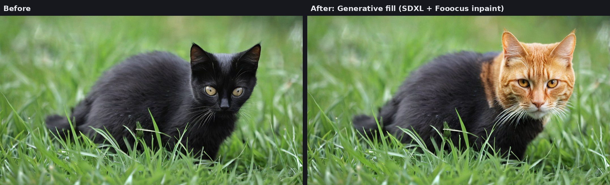

# PhotoCraft × ComfyUI bridge

Generative Fill, Generative Expand (outpaint), image-to-image and text-to-image for
[PhotoCraft](https://github.com/storytold/photocraft), computed locally by [ComfyUI](https://github.com/comfyanonymous/ComfyUI).
Each result lands in your document as a **new layer with an editable soft layer mask**, the way Photoshop does it.



> Unofficial community project. It is not affiliated with ArtCraft / Storyteller. PhotoCraft is in early alpha
> and so is this bridge.

[Polska wersja README](README.pl.md)

```
 PhotoCraft (--control 7878)          bridge (python -m pccomfy)                ComfyUI :8188
 ┌───────────────────────┐   JSON/TCP  ┌──────────────────────────┐  HTTP + WS  ┌─────────────┐
 │ selection + layers    │ ──────────► │ 1. copy, PNG of image+mask│ ──────────► │ inpaint /   │
 │                       │             │ 2. crop + scale           │             │ img2img /   │
 │ new layer with mask   │ ◄────────── │ 3. paste + layer mask     │ ◄────────── │ txt2img     │
 └───────────────────────┘             └──────────────────────────┘             └─────────────┘
                 ▲     PNG files exchanged via ~/.cache/pccomfy/exchange     ▲
```

## Why a bridge and not a plugin

PhotoCraft plug-ins are sandboxed WebAssembly modules (ABI v1). They have no network or file access and only see
the pixels of one layer, so they can't talk to ComfyUI. PhotoCraft does have a **control channel**
(`--control <port>`), a JSON-lines protocol that can run any of its ~900 commands. This bridge drives it from outside.
See [Notes for PhotoCraft developers](#notes-for-photocraft-developers) for what would make a native version possible.

## Features

| Mode | What it does | Selection | Denoise |
|---|---|---|---|
| **Generative fill** | add, remove or replace something inside the selection | required | 1.0 = new content, 0.6–0.8 = rework what's there |
| **Expand image** | grows the canvas by N px per side and paints the new area | created for you | 1.0 |
| **Image → image** | reworks the whole image or the selected part | optional | 0.3–0.7 |
| **Text → image** | generates from scratch in the selection or the whole canvas | optional | n/a |

- **Fooocus inpaint for SDXL** (same approach as Krita AI Diffusion). It is detected and used automatically when the
  server has [comfyui-inpaint-nodes](https://github.com/Acly/comfyui-inpaint-nodes) and the Fooocus patch files.
- **Soft layer mask**: the layer mask is the same grown and blurred mask the model was given, so results blend in with
  no hard edge, and you can still paint on the mask. You can switch to a hard mask from the selection, or no mask.
- **Variants**: N results become N layers. #1 is visible, the others are hidden underneath.
- **Custom ComfyUI workflows**: export any workflow in API format, tag a few nodes with `pc:` titles, and it shows up
  in the bridge (Flux Fill, Qwen-Image-Edit, ControlNet…).
- Small always-on-top window plus a CLI (`python -m pccomfy run …`) for keyboard shortcuts and scripting.
- Works with an existing Krita AI Diffusion ComfyUI install (same server, models and port).

## Install (Arch Linux; other distros need the equivalent packages)

```bash
sudo pacman -S --needed python-pillow python-numpy tk python-websocket-client
git clone https://github.com/Peszemeszek/photocraft-comfyui-bridge.git ~/photocraft-comfyui-bridge
chmod +x ~/photocraft-comfyui-bridge/photocraft-ai.sh
```

`python-websocket-client` is optional and only gives a "step 12/25" progress bar. Python ≥ 3.11 is required.
With pip instead: `pip install pillow numpy websocket-client`.

## ComfyUI

Any ComfyUI server works. Point `[comfyui] url` in the config at it (default `http://127.0.0.1:8188`).
If you use **Krita AI Diffusion**, its managed server already listens on 8188 while Krita is open, and the bridge uses
its models, including the Fooocus inpaint patch.

## Run

```bash
~/photocraft-comfyui-bridge/photocraft-ai.sh
```

This starts PhotoCraft with the control channel and opens the bridge window once PhotoCraft is listening. Under the hood:

```bash
photocraft --control 7878 \
  --control-token-file ~/.config/pccomfy/photocraft.token \
  --automation-read-root ~/.cache/pccomfy/exchange \
  --automation-write-root ~/.cache/pccomfy/exchange
```

The channel is loopback-only and token-protected. The automation roots confine its file access to the exchange folder.
Environment options for the script: `PCC_PORT`, `PCC_NO_GUI=1`, `PHOTOCRAFT=/path/to/binary` (e.g. an AppImage).

If PhotoCraft is already running with `--control`:

```bash
cd ~/photocraft-comfyui-bridge
python -m pccomfy check   # tests both connections, lists checkpoints and Fooocus status
python -m pccomfy         # the window
```

## Usage tips

- Write the prompt as a description of **what should be inside the selection**, e.g. `head of a ginger tabby cat,
  orange fur, photo`, not "replace the head with…". SD/SDXL don't follow instructions; for that, plug in an
  instruction-edit model (Flux Kontext, Qwen-Image-Edit) as a custom workflow.
- **Denoise 1.0** paints something entirely new that fills the whole selection. **0.6–0.8** keeps the shape, pose
  and lighting of what's there and changes its look.
- **Base res.**: SDXL/Flux around 1024, SD1.5 around 512–768. Small selections are upscaled (up to 2×) for detail,
  large ones downscaled. Going higher than the model's native size gives duplicated objects.
- **Context** controls how much of the surroundings the model sees. **Mask grow/blur** controls how far the result
  reaches past the selection edge.

## Custom workflows

1. Build and test a workflow in the ComfyUI web UI.
2. Give these nodes a title (right-click → Title):
   `pc:image` (LoadImage for the crop), `pc:mask` (LoadImage for the mask, white = generate; follow with ImageToMask),
   `pc:prompt` / `pc:negative` (text nodes), `pc:sampler` (gets seed/noise_seed and denoise),
   `pc:latent` or `pc:size` (gets width/height/batch_size), `pc:output` (PreviewImage/SaveImage).
3. Use **Workflow → Export (API)** to save it into `~/.config/pccomfy/workflows/`, then click **Refresh** in the bridge.

The workflow's own model, steps, CFG and sampler are used as saved. Examples are in [`workflows/`](workflows):
`sdxl-fooocus-inpaint.json` is the built-in Fooocus graph (drag it into ComfyUI to inspect it), and `flux-fill.json` is
Flux.1 Fill (rename the model files to yours).

## CLI

```bash
python -m pccomfy run inpaint -p "ginger tabby cat head" --variants 3
python -m pccomfy run outpaint -p "mountains at sunset" --expand 0 0 512 0
python -m pccomfy run img2img -p "watercolor" --denoise 0.45 -m juggernautXL_v9.safetensors
python -m pccomfy run inpaint -w ~/.config/pccomfy/workflows/flux-fill.json -p "wooden table"
```

## Configuration

All settings are optional. Copy [`config.example.toml`](config.example.toml) to `~/.config/pccomfy/config.toml`.
The window remembers its last settings in `~/.config/pccomfy/state.json`.

## Limitations

- A temporary copy of the document (tab `pccomfy-…`) and the result PNGs are opened briefly, so tabs flicker, and the
  result files can show up in *Open Recent*.
- Don't switch documents or change the selection while a job is running.
- Each step is its own history entry (Canvas Size, Paste…).
- CMYK/Lab/16-bit documents go through 8-bit RGB PNG.

## Tests

```bash
python tests/e2e_headless.py /path/to/photocraft-cli            # headless PhotoCraft + fake ComfyUI, all modes
python tests/e2e_headless.py /path/to/photocraft --desktop      # same against the real desktop app (needs a display)
python tests/gui_smoke.py /path/to/photocraft-cli shot.png       # opens the window, clicks Generate, takes a screenshot
```

`tests/fake_comfy.py` mimics the ComfyUI endpoints and inverts the image. The generated graphs were also validated
against a real ComfyUI 0.41 with comfyui-inpaint-nodes; day-to-day use is with SDXL checkpoints (RealVisXL) on an RTX 4060 Ti 16 GB.

## Notes for PhotoCraft developers

The bridge uses only documented control-channel methods: `ui.inspect` (session), `document.inspect`,
`image.duplicate {mergedOnly}`, `app.save` / `app.open`, `layer.new.layer`, `edit.fill`, `select.*` (all, deselect,
rect, reselect), `layer.select`, `layer.flattenImage`, `file.close`, `document.activate`, `edit.copy`,
`edit.paste {center, target:"mask"}`, `edit.pasteSpecial.pasteInto`, `layer.layerMask.revealAll`,
`layer.renameLayer`, `layer.hideLayers` and `image.canvasSize`. It works, but most of that is a workaround for
moving pixels in and out. What would make this (or a proper plug-in) much cleaner:

1. **Pixel I/O over the control channel.** For example `document.renderRegion {rect, scope: composite|layer|selection}`
   that returns a full-resolution base64 PNG (`doc.render` exists, but only headless and capped at 2048 px), plus
   `layer.newFromImage {data, offset, mask?}`. That would remove the temp document, the file round-trips, the tab
   flicker and the *Open Recent* side effects.
2. **Parity between desktop and headless control.** `session.list` and `doc.place` exist in `photocraft-cli serve`
   but not in the desktop channel.
3. **Plug-in ABI v2 with a permissioned network capability** (e.g. localhost only, user-approved) and panels. With that,
   this could be a real Filter › Generative Fill… plug-in with a prompt field.
4. **Native AI (gap G15).** A "bring your own ComfyUI" backend avoids model licensing questions. The plan for a native
   version is a `crates/ai` client (HTTP + WebSocket), `edit.generativeFill` / `edit.generativeExpand` /
   `image.generate` commands run as background jobs with one history step, and a contextual prompt bar under the
   selection. Happy to help with a PR if that direction is welcome.

Also: at `5f65579` (2026-10-16), `crates/engine/src/presets/mod.rs` failed to compile (`Persisted` missing the
`export_presets` field). A one-line fix: `export_presets: take(&mut m, "export_presets"),`.

## Credits

- [PhotoCraft](https://github.com/storytold/photocraft) by the ArtCraft team
- [ComfyUI](https://github.com/comfyanonymous/ComfyUI)
- [comfyui-inpaint-nodes](https://github.com/Acly/comfyui-inpaint-nodes) and
  [Krita AI Diffusion](https://github.com/Acly/krita-ai-diffusion) by Acly, which inspired the inpaint pipeline
- [Fooocus](https://github.com/lllyasviel/Fooocus) inpaint patch by lllyasviel

## License

Dual-licensed under [MIT](LICENSE-MIT) or [Apache-2.0](LICENSE-APACHE), at your option. This is the same as PhotoCraft,
so code can move upstream freely.
